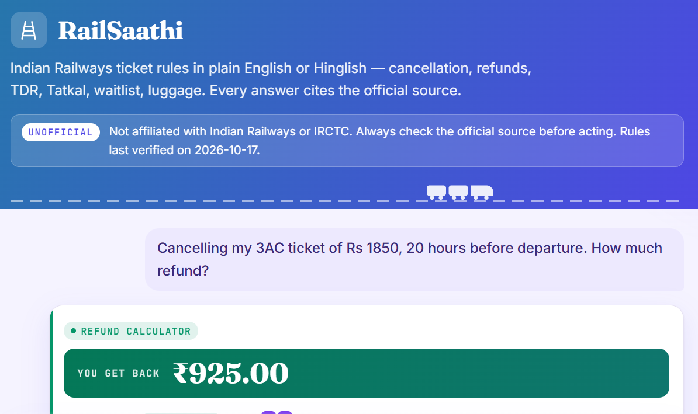
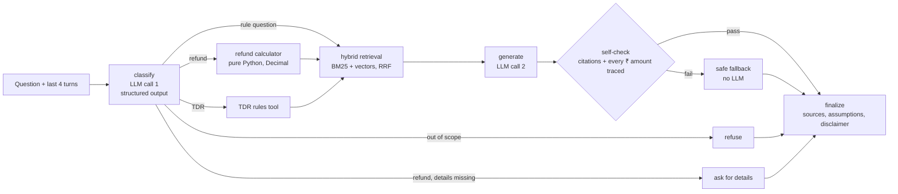
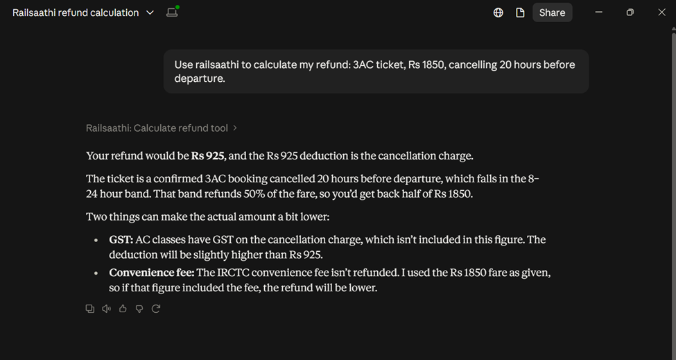

# RailSaathi

**An unofficial assistant for Indian Railways passenger rules**: cancellation refunds, TDR, Tatkal, waitlist/RAC, charting, boarding change and luggage. It answers in **English or Hinglish**, calculates **exact refunds with a tested calculator** (the LLM never does the math), and **cites the official source and effective date** behind every answer.

**Live demo:** https://railsaathi-413499689645.asia-south1.run.app
(If nobody has used it for a while, the first answer takes about 10–20 s while the server wakes up.)

> **Unofficial.** Not affiliated with Indian Railways or IRCTC. Rules last verified on 2026-10-17. Always check the official source before acting.



---

## Why this project

The April 2026 reform changed India's cancellation rules: the old 48/12/4-hour cut-offs became **72/24/8 hours**. Yet IRCTC's own refund page still shows the 2015 rules, and most online answers are outdated. A plain LLM chatbot gets these questions wrong in two ways:
- it **mixes up old and new rules**;
- it **does arithmetic badly**: in my first prototype, the LLM picked the 25% slab when the 50% slab was correct.

RailSaathi fixes both by design:
- **Retrieval over the official documents**, with old rules marked *partly replaced* and linked to the newer rule that replaced them.
- **Deterministic tools** for anything numeric or rule-table-based.
- **Self-checks in code:** every ₹ amount in an answer must come from the tool's output, the question or the retrieved sources, and every citation must point to a real source.

## Results (135-question eval, details in [`evals/README.md`](evals/README.md))

| What                                                             | Result                                                                                                                                                              |
| ---------------------------------------------------------------- | ------------------------------------------------------------------------------------------------------------------------------------------------------------------- |
| Routing on **real user questions** (collected from Reddit/Quora) | **55% → ~93%** after fixing the classifier (3 runs: 94 / 93 / 91%)                                                                                                  |
| Run-to-run noise (same code, run twice)                          | 5% of questions changed route, so smaller differences aren't claimed                                                                                                |
| Exact refund amount (calculator questions)                       | **43 / 44** (the one miss was a routing failure, not a calculation error)                                                                                           |
| In-scope questions wrongly refused                               | **0 / 122**                                                                                                                                                         |
| Hinglish questions detected and answered in Hinglish             | **39 / 39**                                                                                                                                                         |
| Stale-rule traps (user assumes the 2015 rules) corrected         | **10 / 10**                                                                                                                                                         |
| LLM calls per question                                           | ≤ 2 (mean 1.83)                                                                                                                                                     |
| Latency                                                          | p50 **3.1 s**, p95 **3.8 s**                                                                                                                                        |
| LLM-judge faithfulness (DeepEval, Gemini 3 Flash judge)          | 0.91 mean; **judge validated against human labels: 56% agreement**. The judge penalised omissions, not errors, so the human-checked sample is reported alongside it |

**The eval found the most important bug.** On the first baseline, routing was 97% on my clean drafted questions but only **55% on real ones**. The classifier treated *any* mention of "refund" as a request to calculate one, so "is there a fee for waitlisted tickets?" got "tell me your class and fare". Drafted questions alone would have hidden this.

## How it works



- **Data:** 13 official documents (PIB releases, IRCTC refund rules, commercial circulars, Gazette notification, FAQs) → 69 rule-level chunks. Each chunk records its effective date and status. OCR (Tesseract, eng + hin) is used for scanned pages.
- **Retrieval:** BGE-small embeddings (local ONNX via fastembed) + BM25, merged with Reciprocal Rank Fusion. On the retrieval dev set, hit@5 is **96%** (vector-only: 86%), and Hinglish hit@3 went from **40% to 80%**. When a retrieved rule has been superseded, the newer rule is retrieved and placed first.
- **Tools:**
  - **Refund calculator:** 11 rules and 7 written assumptions; 25 unit tests and 7 property-based tests (Hypothesis, 2,000 cases each), for example "the refund never increases closer to departure".
  - **TDR tool:** 10 situations; 80 tests.
- **Agent:** LangGraph with at most **2 LLM calls** per question; every path ends in `finalize`. The sentence listing assumed ticket details is written by code, not the LLM, after the LLM once invented an assumption.
- **API and UI:** FastAPI with Pydantic validation; per-IP rate limits (5 per minute, 40 per day) and a global daily cap; privacy-safe logs (metadata only, never the question text). The UI is one HTML file with no framework. Model output is rendered as text only (XSS-safe), and history is kept only in the browser tab.
- **MCP server:** the calculator, TDR tool and rule search are also exposed over **MCP**, so any MCP client can use the same tested tools:



## Tech stack

Python 3.12 · LangGraph · Gemini 3.5 Flash Lite · fastembed (BGE-small) · Chroma · rank-bm25 · FastAPI · slowapi · Pydantic · pytest + Hypothesis (153 tests) · DeepEval · Docker · Google Cloud Run · Secret Manager · MCP

## Run it locally

```bash
git clone https://github.com/Sidified/railsaathi && cd railsaathi
python -m venv .venv && source .venv/bin/activate
pip install -r requirements.txt
cp .env.example .env            # add GOOGLE_API_KEY and GEMINI_MODEL

# build the index from data/raw (extract -> chunk -> index)
python -m src.ingestion.extract && python -m src.ingestion.chunk && python -m src.ingestion.index

python -m pytest tests/ -q      # 153 tests, no API calls (LLMs are faked)
uvicorn src.api.main:app --reload    # http://localhost:8000
```

- **MCP server:** `python -m src.mcp_server` (stdio).
- **Evals:** `python -m evals.run_app`, then `python -m evals.score`. See [`evals/README.md`](evals/README.md).
- **Deploy:** `Dockerfile` + `gcloud run deploy --source .` (the index and the embedding model are baked into the image; the API key comes from Secret Manager).

## Design decisions

| Decision                                  | Why                                                                                                                     |
| ----------------------------------------- | ----------------------------------------------------------------------------------------------------------------------- |
| LLM never does math                       | A tested calculator is exact; the LLM only explains the result. Self-check rejects any ₹ amount that has no source.     |
| Hybrid search, not vectors only           | Rule text is full of exact terms ("TDR", "clerkage", "RAC"). BM25 catches them; vectors catch paraphrases and Hinglish. |
| Old rules kept, but marked                | Users still quote the 2015 rules; the system must recognise them and correct them, not pretend they never existed.      |
| Max 2 LLM calls, a deterministic fallback | Predictable cost and latency; a safe answer even when the LLM's answer fails the checks.                                |
| No server-side memory                     | The client sends the last 4 turns, so nothing personal is stored.                                                       |
| One HTML file UI                          | Nothing extra to build or deploy; served by the same FastAPI app.                                                       |
| `max-instances 1` on Cloud Run            | The daily cap lives in memory, so one instance means one true global cap and a hard limit on cost.                      |

## Known limitations

- **Dev-set results:** the classifier prompt was tuned on the same 135 questions (3 rounds, then frozen).
- **Classifier noise:** about 5% of questions change route between identical runs, because the model ignores the temperature setting.
- **Known failures:**
  - a waitlisted ticket that gets RAC was once described as "reserved";
  - one stale-trap question with full details didn't get an amount;
  - confirmed Tatkal without a fare asks for the fare (the refund is ₹0 anyway);
  - 2 topics that are in the documents got "not sure" answers.
- **Assumptions:** the 2026 documents don't publish new flat charges, so the 2015 amounts are used. This is written down as assumption A1 and shown to users.
- **Greetings:** "hi" / "how can I use you?" get the out-of-scope reply. It's polite and lists what RailSaathi covers, but a welcome message would be better.

## v2 ideas

- A held-out test set (fresh real questions, run once) for a clean number
- An `about_app` intent with a proper welcome message for greetings and help questions
- A custom faithfulness metric that doesn't penalise omissions; more human labels
- Streaming answers (server-sent events)
- Premium Tatkal, counter tickets, cancelling only some passengers, fare-difference amounts (AC failure / lower class), checks for deadlines that have already passed
- Concession rules; comparing BGE with Gemini embeddings
- Redis for the daily cap if it ever needs more than one instance

---

Built by **Siddharth Choudhary** ([@Sid_Hary_](https://x.com/Sid_Hary_)). Feedback welcome.