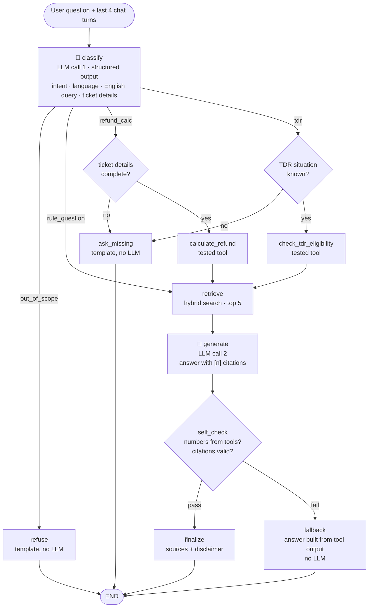

# RailSaathi Agent Graph (LangGraph)

Max **2 LLM calls** per question. Nodes marked 🤖 call the LLM; all others are plain code.

## LLM calls per path
| Path                        | LLM calls |
| --------------------------- | --------- |
| Out of scope                | 1         |
| Missing details             | 1         |
| Normal answer               | 2         |
| Self-check fails → fallback | 2         |

## Key design choices
- **Classify uses structured output** with the same types as the tools, so it can only produce values the tools accept.
- **Missing details are asked for, never guessed.**
- **Numbers come only from tested tools.** The LLM writes the words; self-check rejects any ₹ amount not found in tool output, user input or a cited source.
- **Fallback instead of retry:** if self-check fails, a deterministic answer is built from the tool output (no 3rd LLM call).
- **No server-side memory:** the client sends the last 4 turns, so no personal details are stored.